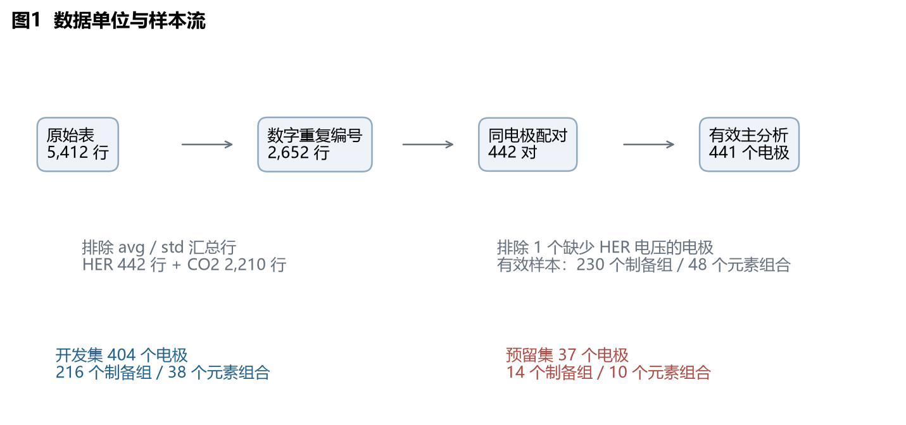
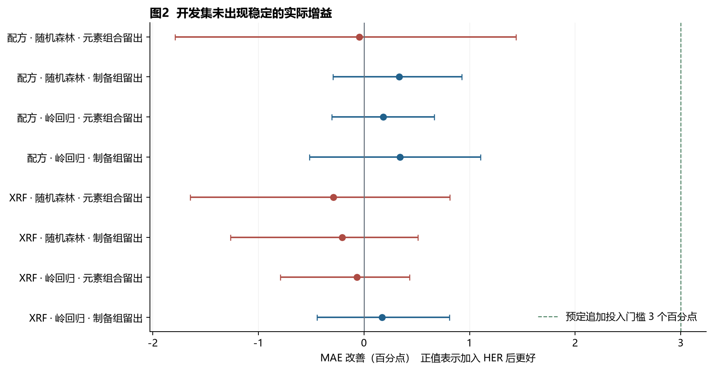
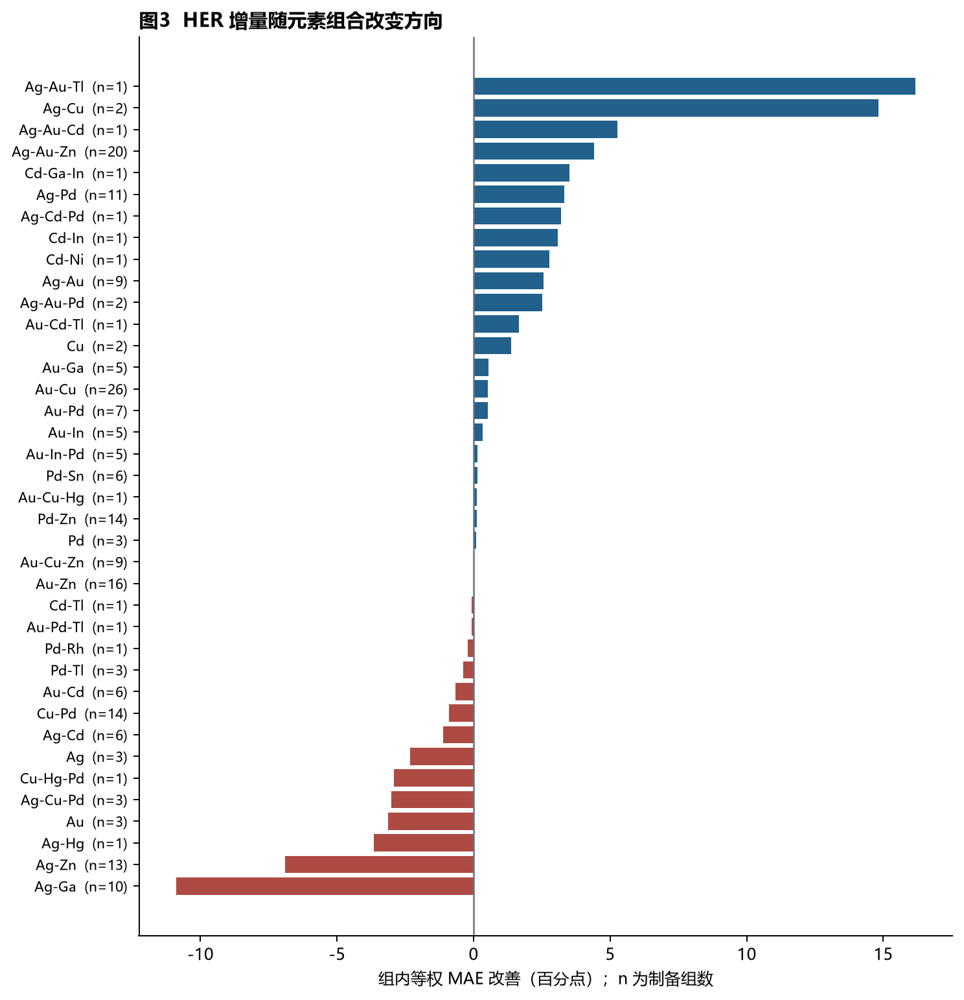
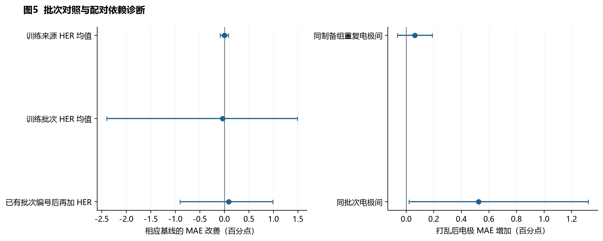
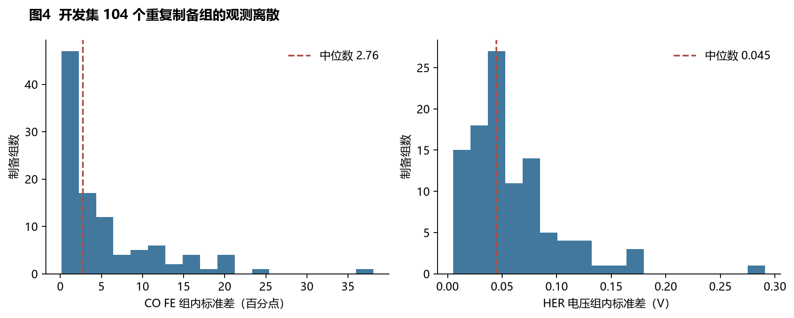
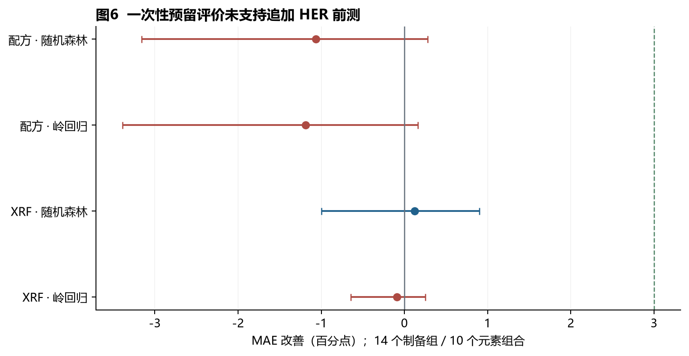
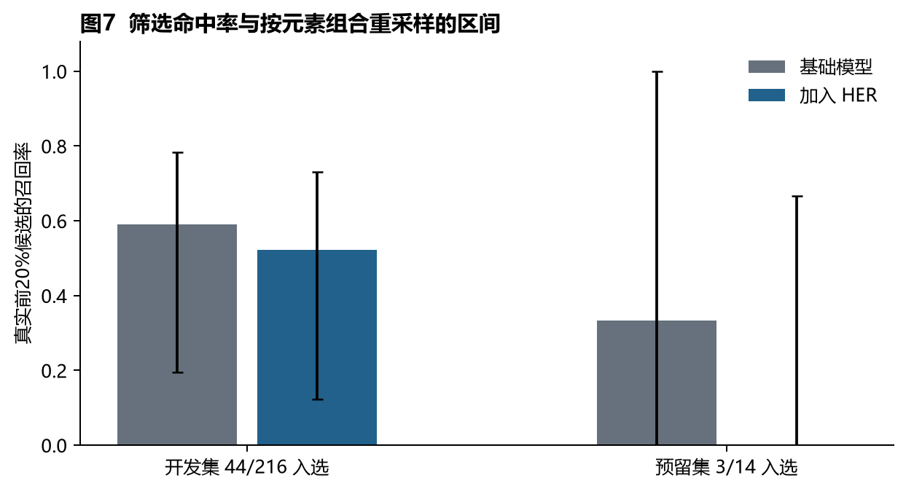

# HER前测对CO选择性预测的增量研究报告

**JIN HANZHE** · Independent Researcher, Chongqing, China · jinhanzhe09@gmail.com

原分析：2026-10-12；公开整理：2026-10-22。**[v1.0.0](https://github.com/SHIN09-git/ocx24-her-co-selectivity/releases/tag/v1.0.0)，发布日期 2026-10-22**。本报告未投稿、未同行评审；未开展湿实验。原创报告采用 CC BY 4.0，OCx24 数据另保留其原作者署名。见[署名披露](../AUTHORSHIP.md)与[许可范围](../LICENSING.md)。

本报告保留原分析的数值与结论。公开版复算是已完成分析的重放，不构成新的盲测。

在当前OCx24数据、预定模型和分组评价下，HER前测未显示达到预定门槛的稳定CO选择性预测增量。开发集主比较的MAE由 **13.76** 变为 **13.80 个百分点**；一次性预留评价由 **11.26** 变为 **12.33 个百分点**。已按原计划的停止规则收束正向材料筛选路线，保留本次负结果与可复现方法。此结论不是“HER在任何条件下都无用”，也不是新材料或机理发现。

## 研究范围与完成口径

本次执行原计划的首期计算课题，问题是：已制成电极在任何CO₂测试开始前，增加50 mA cm⁻²下的HER全电池电压，是否改善随后200 mA cm⁻²下直接测得的CO法拉第效率预测。法拉第效率表示电量用于生成该产物的比例，误差以百分点报告。

已完成数据配对、输入审计、本地方案冻结、嵌套分组验证、预定反证分析、一次性预留评价、图表和复现材料。原计划中的十二周是工作包安排，本次按依赖顺序完成可自动执行部分，没有声称开展了十二周实验。阴性结果允许按停止路径交付。

原研究记录中的 AI 复核覆盖20条指定记录、全部441个有效配对、6项映射异常、216个批次日期差异记录，并使用另一计算实现复算23项保存结果的统计。本公开版提供相应自动检查入口及[实际运行验证记录](../VALIDATION.md)。这些检查未建立独立人工、实验室或外部同行评审；工具使用与历史授权的边界见[署名披露](../AUTHORSHIP.md)。

## 数据与质量

数据固定到FAIR-Chem提交`0a625a8924cf0a87dffbcd2f0ac58d82ca43bfa4`。原始文件及下载SHA256保存在项目中，源文件未覆盖。[OCx24原文](https://arxiv.org/html/2411.11783v1)与[官方数据入口](https://facebookresearch.github.io/fairchem/ocx24/)说明了顺序测试协议。

|分析集合|电极数|制备编号数|元素组合数|
|---|---|---|---|
|原始有效配对|441|230|48|
|官方清理表中的配对|433|226|46|
|保守XRF映射子集|433|225|47|
|开发集|404|216|38|
|预留集|37|14|10|

原表5412行含平均与标准差行；数字重复编号仅2652行，其中HER 442行、CO₂ 2210行。442个编号可一对一配对，排除1个缺少HER电压的电极后有441对。230个制备编号不自动等同230次独立合成。所有重复电极及原生电流点均受同一分组约束。

XRF源表有重复编号折叠后的冲突。3个入组电极的映射不能唯一确定，保守XRF分析中不采用其值。官方清理表和保守XRF子集都恰有433个电极，但成员不同，不能交换分母。批次元数据日期与原表涉及216个电极不一致；使用可核对的来源加批次编号作敏感性输入，不把日期或CSV顺序解释为时间轴。

全体CO₂原生点有47条气体FE总和超过100%、25条液体余量为负、3条H₂ FE超出0–100%的记录；CO FE本身没有超界。保留原值和标记，没有强制归一化。开发集敏感性分析排除预定质量标记后余399个电极，主结论未改变。液体余量并不是乙醇或甲醇的直接测量。

## 冻结方案和防止答案泄漏

以目标配方的元素集合划分48组，固定种子20261012随机选择10组作为预留。结果是37个电极、14个制备组；没有因样本不均衡或模型效果重抽。开发集404个电极、216个制备组用于五折外层、四折内层分组验证。该预留发生在公开数据预审计之后，只能称后续模型的预留测试，不能称完全未接触数据的盲测。

主算法预先指定为受限随机森林，岭回归为稳健性比较。随机森林128棵树，深度3或6，最小叶节点样本3或8；岭回归α为0.1、1、10或100。各模型在训练折内按同一评分规则选参。数值填补、缩放、分类编码均只在训练折拟合。未知来源或批次使用预定未知类别处理。

M0输入13种元素的配方比例与合成来源；M1只增加同电极HER全电池电压绝对值。另以无歧义XRF组成作为另一信息预算，在同一子集内重跑两模型。没有输入任何CO₂电压、CO₂早期电流段读数、其他产物FE、分电流、产率或能耗。

训练和主评分均使每个制备组等权：先计算一组内电极绝对误差的平均，再对组平均。两模型FE预测统一截到0–100%，原始标签不截断。改善定义为`M0 MAE − M1 MAE`，正值有利于HER。95%区间为对留出元素组合进行10000次成组自助重采样的百分位区间，条件是已拟合的预测固定；它不包含所有模型训练、独立实验室或样本选择不确定性。

方案是本地冻结文件，未进行公开预注册。冻结、最终预测保存和解封的时间与哈希均有记录。最终全部12个模型先仅用开发标签训练并保存预留预测，再一次性读取预留标签。解封后没有追加模型搜索。

## 开发集主比较

|比较|制备组|M0 MAE|M1 MAE|改善|改善95%区间|
|---|---|---|---|---|---|
|配方 / 随机森林 / 元素组合留出|216|13.76|13.80|-0.04|[-1.79, 1.44]|
|配方 / 随机森林 / 制备组留出|216|9.12|8.79|0.33|[-0.29, 0.93]|
|配方 / 岭回归 / 元素组合留出|216|15.41|15.23|0.18|[-0.31, 0.67]|
|配方 / 岭回归 / 制备组留出|216|12.47|12.13|0.34|[-0.52, 1.10]|
|XRF / 随机森林 / 元素组合留出|211|13.56|13.85|-0.29|[-1.65, 0.81]|
|XRF / 随机森林 / 制备组留出|211|9.47|9.68|-0.21|[-1.27, 0.51]|
|XRF / 岭回归 / 元素组合留出|211|14.07|14.14|-0.07|[-0.79, 0.43]|
|XRF / 岭回归 / 制备组留出|211|12.65|12.48|0.17|[-0.45, 0.81]|

跨元素组合的配方随机森林改善为-0.04个百分点，区间[-1.79, 1.44]。跨制备组存在约0.33个百分点的小幅均值改善，但未达到3个百分点和10%相对降低的投入门槛。该门槛是原计划的资源判断规则，不是领域标准，也不是预先证明的统计功效。

各元素组合的改善方向不一致。图中n为制备组数，不能把小组的较大变化单独当成可推广规律。最大元素组合的移除、来源内分析和跨来源压力测试均已保存；它们不是独立实验室外部验证。

按冻结方案补齐各验证折单独的筛选成绩如下。每折选前20%共46个名额，M0与M1均命中18个；这与跨折合并后选44个名额的描述性评价定义不同。不同折的效果有增有减，不能仅选择改善的折作结论。

|验证折|候选制备组|前20%名额|M0命中|M1命中|召回率|
|---|---|---|---|---|---|
|1|61|13|3|6|23.1% → 46.2%|
|2|64|13|7|1|53.8% → 7.7%|
|3|36|8|3|5|37.5% → 62.5%|
|4|44|9|4|4|44.4% → 44.4%|
|5|11|3|1|2|33.3% → 66.7%|

## 反证分析与观测离散

训练来源HER均值的改善为0.000个百分点，训练批次均值为-0.037个百分点。在已加入批次编号的基线上，个体HER改善为0.088个百分点，区间跨零。结果不足以证明一个稳定的个体信号，也不足以声称HER严格只编码批次。

在104个有重复的开发制备组、292个电极中，仅打乱验证组内部的HER配对，电极等权MAE平均增加0.063个百分点，95%区间[-0.064, 0.189]。此处有意用电极级误差检验个体配对，不用组均值排名作证据。批次内打乱的误差增加较大，但它同时破坏组成关联，不能单独作为个体状态的证明。置换是已训练模型的依赖诊断，不是随机干预的因果检验。

开发重复组的CO FE组内标准差中位数为2.76个百分点，平均为5.41；HER标准差中位数为0.045 V。组内留一重复预测的参考MAE为6.35个百分点。这是已记录重复的离散度，不是模型不可突破的严格误差下限，也不覆盖所有独立合成波动。

|敏感性或诊断比较|制备组|M0误差|M1误差|改善|单位|
|---|---|---|---|---|---|
|配方 / 随机森林 / 批次留出|216|15.93|15.17|0.76|百分点|
|配方 / 随机森林 / 元素组合留出 / 电压输出|216|0.1114|0.1012|0.0102|V|
|配方 / 随机森林 / 元素组合留出 / H₂输出|216|18.47|17.99|0.48|百分点|
|配方 / 随机森林 / 来源留出|216|16.94|16.08|0.85|百分点|
|官方清理样本子集|212|15.18|14.53|0.65|百分点|
|排除质量标记记录|214|13.63|13.61|0.01|百分点|
|仅化学还原来源|80|11.72|11.98|-0.26|百分点|
|仅火花烧蚀来源|136|16.50|16.07|0.44|百分点|
|移除最大元素组合|190|13.31|12.93|0.38|百分点|

电压输出的均值误差略有降低，但元素组合重采样区间仍跨零。不能据此确定HER信号来自装置电阻，更不能把电压改善写成CO选择性改善。跨来源仅有两种合成路线；按元素组合计算的区间不代表对实验室总体的推断。

### 压力测试中的输入覆盖

|验证方式|验证折|训练集中未出现的测试元素|涉及测试电极|
|---|---|---|---|
|批次留出|1|Ni|2/70|
|批次留出|2|Rh|3/54|
|批次留出|3|Sn|14/154|
|批次留出|4|无|0/83|
|批次留出|5|无|0/43|
|来源留出|1|Cd Hg Ni Rh Tl|72/214|
|来源留出|2|Sn Zn|106/190|

批次留出的三个折分别缺少测试中的Ni、Rh或Sn，合计涉及19个电极。两个来源留出方向分别有72/214和106/190个电极含训练未见元素，所以该压力测试同时改变合成来源与元素空间，不能分离二者的效应。主元素组合留出也有19个电极涉及折内未见元素；最终37个预留电极的所有元素均在完整开发集出现，但元素组合未见。

按19个批次而非元素组合补充重采样，批次留出的改善仍为0.76个百分点，95%区间[-0.51, 2.27]。这是对保存预测的补充不确定性报告，不改变原冻结主分析。由于仅有两种合成来源，不另报告代表“来源总体”的精确置信区间。

各折覆盖表、各折筛选表、预留逐家族误差和移除单个评价家族的影响表已分别保存。本次在解封后的交付审计中补齐这些报告项，没有重新拟合或选择模型，也没有产生新的独立验证。

## 一次性预留评价

|CO FE模型|M0 MAE|M1 MAE|改善|改善95%区间|前3名命中数|
|---|---|---|---|---|---|
|配方 / 随机森林|11.26|12.33|-1.06|[-3.16, 0.28]|1 → 0|
|配方 / 岭回归|9.14|10.33|-1.19|[-3.39, 0.16]|2 → 1|
|XRF / 随机森林|11.79|11.66|0.12|[-1.00, 0.90]|1 → 0|
|XRF / 岭回归|11.15|11.24|-0.09|[-0.65, 0.25]|2 → 2|

预留集中36个电极来自化学还原、1个来自火花烧蚀；对应13个和1个制备组。小样本及来源不均衡限制了结论精度。配方主模型的改善为-1.06个百分点，区间[-3.16, 0.28]。XRF随机森林虽有约0.12个百分点正值，也未接近预定实际门槛。不能从一个正或负均值推断普适规律。

预留集的H₂诊断误差由16.11变为16.68个百分点；CO₂全电池电压误差由0.0678降至0.0625 V。两项改善的元素组合重采样区间均跨零，未建立稳定的“只改善电压”信号，也不能据此断定HER信息来自某个装置部件。

主模型按预测组均值选前20%，开发集取44/216组，真实前列命中26→23组；预留集向上取整取3/14组，命中1→0组。开发集跨折汇总排序只作描述性筛选评估，来自不同折的预测并非一个共同训练模型。预留筛选区间很宽，不能将零命中解释为模型永远失败。

记录内重复重采样得到实测前列名单平均Jaccard重合度0.909，M0为1.000、M1为0.971。M0同组输入完全相同，稳定度1是模型结构的结果，并非预测准确的证据。单次记录的未观测变异和模型重新训练的不确定性不在此指标中。

## 单位复核与文献差异

本节只针对提交 0a625a8924cf0a87dffbcd2f0ac58d82ca43bfa4，不宣称当前上游版本仍有此问题。该固定版本乙烯产率函数使用电子数2，而CO₂到C₂H₄的配平需要12电子。直接反应式为`2CO₂ + 12H⁺ + 12e⁻ → C₂H₄ + 4H₂O`。在处理表79条CO与乙烯均可比的记录中，消去共同插值因子后的比值为6；原生点重算也保留了相应量纲比较。此问题影响绝对摩尔产率，不代表乙烯FE错六倍，不是本项目CO FE负结果的原因。不能用这一常数修正替代主课题所需的预测增量。

原文已采用组成留出，并已报告CO FE预测及其困难。本项目限定的新增检验是前置实测HER的增量。已阅读原文相关方法、附录与公开训练代码，并进行定向同题检索；未发现完全同题且同等级验证的研究，但这不是穷尽性排重。原研究保存的背景阅读材料不随本公开包分发；下方保留参考入口，并区分摘要与完整正文。公开整理未新增穷尽性文献检索。

## 结论与停止范围

H1的实际增量未获得支持；H2的稳定迁移增益未获得支持；H3的个体电极状态解释未建立。有限数据与模型不能证明真实效果严格为零。当前证据不支持按原计划追加投入发展正向材料筛选论文或新材料验证。

依据第二停止节点，未启动M2/M3扩展建模、五电流点模型扩展和乙醇或氨第二阶段。XRD/DFT资料的输入覆盖已经登记，但没有把未执行的比较写成结果。没有外部兼容数据时，结论仅为OCx24公开平台内部的留出评价。

若将来重新立项，应先出现新的信息来源或独立平台数据，再冻结新方案；不要继续复用本次已解封测试集调参。原计划的九块电极合作验证是后续建议，当前负结果不支持把它作为已批准实验启动。要检验“做HER是否改变CO₂性能”，还需另设有无HER处理的随机对照；现有顺序观测无法回答。

## 交付与复核记录

- [数据字典](数据字典.md)、[主输入表](../02_data/features.csv)及其原始行号提供逐值溯源。
- [冻结方案](../00_admin/preregistered_analysis_plan.json)、[原始解封记录](../00_admin/holdout_unsealed.json)和保存预测保留历史证据。
- [复现说明](../REPRODUCING.md)：快速核查与完整重训均输出到新目录，不覆盖冻结文件。
- [发布验证记录](../VALIDATION.md)：列明公开整理时实际执行的检查、平台与范围。
- [上游来源清单](../01_sources/download_manifest.json)及[打包变更记录](../provenance/PACKAGING.md)：原始文件哈希与公开整理差异。
- [署名与 AI 披露](../AUTHORSHIP.md)、[第三方归属](../THIRD_PARTY_NOTICES.md)与[许可范围](../LICENSING.md)。

## 参考资料

1. Abed等，Open Catalyst Experiments 2024，arXiv:2411.11783v1。[原文](https://arxiv.org/html/2411.11783v1)。
2. FAIR-Chem OCx24。[数据与许可](https://facebookresearch.github.io/fairchem/ocx24/)；[固定版本代码](https://github.com/facebookresearch/fairchem/tree/0a625a8924cf0a87dffbcd2f0ac58d82ca43bfa4/src/fairchem/applications/ocx)。
3. Chen等，Large language model enhanced corpus of CO₂ reduction electrocatalysts and synthesis procedures，Scientific Data 11, 347 (2024)。[DOI](https://doi.org/10.1038/s41597-024-03180-9)。
4. Arabyarmohammadi等，Voltage distribution within carbon dioxide reduction electrolysers，Nature Sustainability 8, 1592–1600 (2025)。本次取得摘要页面。[DOI](https://doi.org/10.1038/s41893-025-01643-4)。
5. Scaler Transfer A Simple and Data-efficient Simulation-to-Real Transfer Scheme for Materials。检索与初次可读网页范围，未保存完整PDF。[OpenReview](https://openreview.net/pdf?id=klKNrG13Wj)。
6. Leap Labs，Claude Meets Disco，机构案例网页。[出处](https://www.leap-labs.com/research/claude-meets-discovery-engine-part-i)。

本文所有新统计数字由本地代码从固定数据计算，未将研究假设或原作者声明写成本次模型结果。
